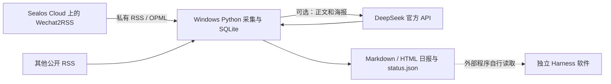

# 大学信息雷达 · University Information Radar

我开发这个项目，是为了把分散在多个公众号中的校园资讯整理成便于浏览的日报。我用 Wechat2RSS 提供订阅来源，用 Python 完成采集与去重，用 DeepSeek 提取正文和海报信息，再由独立的 Harness 读取日报并通过其已授权的 IM 功能发送微信消息。

[下载 v0.6 脱敏代码包](https://github.com/s17735674382-ops/WeChat-Official-Account-Automated-Retrieval-and-Summarization-System/blob/main/downloads/university-information-radar-v0.6-public.zip) · [核对压缩包 SHA256](https://github.com/s17735674382-ops/WeChat-Official-Account-Automated-Retrieval-and-Summarization-System/blob/main/downloads/university-information-radar-v0.6-public.zip.sha256)

这是 v0.6 的脱敏代码发布副本。仓库不包含真实订阅、个人数据库、文章、图片、报告、云服务凭据或 API Key。我通过 Codex 协作开发本地程序；Wechat2RSS 与模型服务属于外部依赖，不在本仓库重新分发。

## 项目组成



本项目负责本地采集、分析与报告文件。微信公众号转 RSS 的云端方法见 [云端技术说明](docs/cloud-method.md)，模型接入与证据校验见 [DeepSeek 技术说明](docs/deepseek-method.md)，环境及成本见 [环境与服务清单](docs/environment-and-services.md)。本项目不实现微信发送。

## 我的使用路径

1. 我购买 Wechat2RSS 私有部署授权，在 Sealos Cloud 部署其容器服务，并配置持久化与 HTTPS。
2. 我依据 [Wechat2RSS 官方使用文档](https://wechat2rss.xlab.app/deploy/guide) 完成正常授权、添加需要关注的公众号，再把订阅通过 OPML 导入本地程序。
3. 我让 Windows 计划任务每天10:00启动采集与可选的 API 分析，报告完成后写入 reports。
4. 我的微信推送方案是在 DeepSeek Harness 中单独配置10:10任务，只读取当天报告并发送到已确认的微信会话。仓库提供配置提示词，实际任务是否生效仍需在自己的 Harness 中验证。

我没有在本仓库重新实现 Wechat2RSS，也没有公开自己的公众号列表。部署、账号授权、订阅和故障处理请以 [Wechat2RSS 官方文档](https://wechat2rss.xlab.app/deploy/) 为准，本仓库只说明接入路径。读者可按照 [订阅设置指南](docs/subscriptions.md) 配置自己的来源。

Harness 的具体操作与可复制提示词见 [每日微信推送配置](docs/harness-push.md)。该文档是我给外部软件的任务要求，不表示本仓库已实现微信发送，也不表示任何 Harness 安装都具备相同接口。

## 已有功能

- 普通 RSS / Atom 阅读，OPML 批量导入 Wechat2RSS 订阅，按原文链接与稳定 ID 增量去重。
- 手动粘贴公众号正文，或通过公开 HTTP 尝试导入单篇文章，不绕过访问限制。
- SQLite 保存、备份和安全的单篇删除；只管理项目中的图片副本。
- 可选的正文与 PNG/JPEG 海报分析，保留证据，未确认字段为空。
- 每日任务、请求硬超时、调用量限制、单实例锁和失败记录。
- `complete` / `partial` 日报；全部采集失败也生成故障简报，不冒充“没有新增”。

## 快速开始

已验证环境为 Windows、64 位 Python 3.14、PowerShell 7。Python 程序只使用标准库，不需要运行 pip install。其他系统和 Python 版本尚未完整验证。

```powershell
Set-Location '你下载的项目文件夹'
Copy-Item .\config.example.json .\config.json
python -B -X utf8 .\main.py
```

若 `python` 命令不可用，请用你自己的 Python 可执行文件完整路径，不需要为此重新安装 Python。`config.json` 是本地配置，已被 Git 忽略；示例配置只有公开测试 RSS，付费开关和每日自动分析默认关闭。

先用菜单1测试公开 RSS。公众号订阅需自行部署服务，再从菜单8导入自己的 OPML；OPML 可能含访问凭据，应保留在本地，不上传仓库。完整步骤见 [如何设置自己的公众号订阅](docs/subscriptions.md)。本仓库不提供我的公众号订阅清单。

## 每日日报

```powershell
# 采集并出报；只有明确打开两项付费开关、提供自己的 Key 后才会调用 API
python -B -X utf8 .\main.py --daily-run

# 仅依据本地已有记录生成报告，不采集、不调用 API
python -B -X utf8 .\main.py --generate-report
```

文件输出到项目内 `reports/YYYY-MM-DD.md`、`reports/YYYY-MM-DD.html` 和 `reports/status.json`，按北京时间命名；不会生成 latest 文件。HTML 可用浏览器打开。

- `complete`：必要采集与分析均完成。
- `partial`：来源失败、暂为空而无法确认覆盖、分析失败/未完成、海报遗漏或超时；仍是可以读取和发送的正式报告。
- `failed`：数据无法可靠读取或正式报告无法可靠写出。

统计按发现/入库时间，从上一次 complete 报告截止时间延续；首次采用前24小时。第一次采集可能发现 RSS 中较早的文章，不能据此认定都是当天发布。每天只采一次仍可能遗漏已从有限 RSS 历史中移除的文章。

读取报告的外部软件应检查当天状态为 complete 或 partial，核对文件内 report_id 与状态文件一致，以及 markdown_sha256；再次读取状态确认 report_id 未变化。文件不匹配时稍后重读。源、报告和 Key 都不需要提供给仓库维护者。

## 选择启用 DeepSeek

Key 只通过环境变量 `DEEPSEEK_API_KEY` 提供。当前窗口可用隐藏输入设置：

```powershell
$env:DEEPSEEK_API_KEY = Read-Host '输入自己的 DeepSeek API Key' -MaskInput
```

需要调用模型时，将本地 `config.json` 的 `deepseek.paid_api_enabled` 设为 true；每日自动分析还需要 `daily.enabled` 为 true。日任务无需逐篇确认，可能产生费用；原菜单5仍保留 ANALYZE 确认。默认每天最多10次请求，超时60秒，付费请求默认不自动重试。

无人值守任务需使用用户级环境变量：在 Windows 的“编辑账户的环境变量”界面设置 Key，任务启动脚本读取它。不要把 Key 写进 PowerShell 文件、配置、提交或工单。

## Windows 每天10:00运行（自行选择启用）

先确认系统时区为中国标准时间，并手动验证一次。公开副本不包含任何已经注册的任务。使用 PowerShell 7：

```powershell
# 自动寻找常见安装位置；也可以明确提供自己的 Python 路径
.\register_daily_task.ps1 -PythonPath '你的Python完整路径\python.exe'
```

脚本使用当前用户、固定的项目与解释器路径，每天当地时间10:00启动，错过后补运行，已运行时不重复启动；不会立刻执行。电脑需要开机并登录，可锁屏，能否从休眠唤醒还取决于系统与硬件。若补运行发生在第二天，按实际执行日期出报。日志写到 `logs/日期.log`。

复制或搬迁项目后应重新注册任务；不要同时运行同一套数据的多个副本或额外的30分钟采集任务。更多环境限制见 [环境说明](docs/environment-and-services.md)。

## 测试与模块

```powershell
python -B -X utf8 -m unittest test_v03 test_v04 test_v041 test_wechat2rss test_daily -q
```

测试使用临时数据库、人工测试文章/纯色图片和模拟模型响应；测试成功不代表真实 OCR 已准确完成。Windows 硬链接与目录联接点测试需要相应系统权限。项目开发记录包含70项免费测试，公开副本的实际验证结果见 [发布检查](docs/release-check.md)。

| 文件 | 作用 |
|---|---|
| main.py | 菜单、RSS阅读、命令行入口 |
| wechat.py / safe_http.py | 文章保存、手动导入、安全HTTP |
| wechat2rss.py | OPML与增量采集 |
| image_import.py / data_management.py | 图片校验、备份与删除保护 |
| deepseek_analysis.py / daily_analysis.py | 视觉分析、日报图文分析适配 |
| daily_pipeline.py / daily_reports.py | 每日编排与报告发布 |
| register_daily_task.ps1 / run_scheduled_daily.ps1 | 可选的Windows计划任务 |

限制：活动和日期需人工核对；二维码不能推测报名地址；云服务不可用会影响覆盖；默认图片数量、格式和时间预算可能导致 partial。项目不包含模型权重、Wechat2RSS 商业镜像、云账号、真实账单或用户数据。
